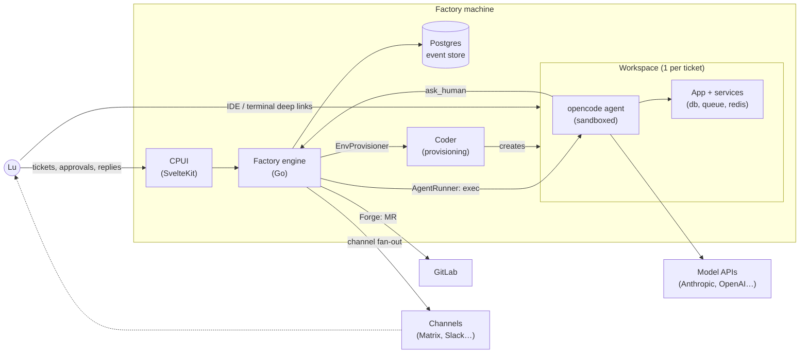
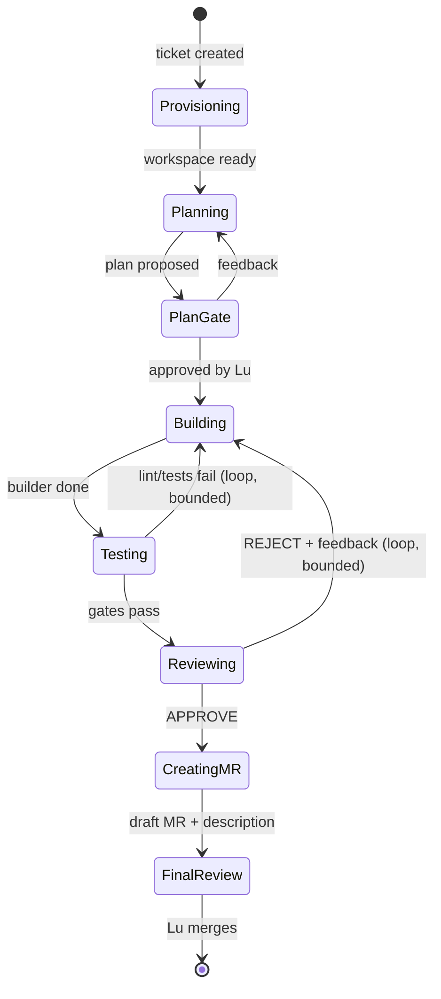

# Apothecary Software Factory — Light Plan (v0.1)

> Status: **draft — awaiting approval**. Once approved, a detailed design follows
> (flow schema, port interfaces, event catalog, project layout).

## 1. The idea

A software factory called Apothecary: a ticket goes in, a reviewed merge request comes out.
AI agents and deterministic gates alternate along a configurable flow, running
inside disposable, sandboxed environments. Human involvement shrinks over time,
driven by data — the target end state is **two touchpoints per ticket: plan
approval and final review**.

The factory is a feedback-loop machine as much as a build machine: every run
records what happened, where agents stalled, and what human help was needed,
so the flow itself can be improved and compared across versions.

## 2. Principles

- **Sturdy and light.** Smallest structure that scales; only what's needed now, easy to extend later.
- **Engine in the control plane, not in the workspace.** Workspaces are dumb, disposable execution cells; all state and orchestration live centrally.
- **Vendors behind ports.** Coder, opencode, GitLab, Matrix are adapters behind engine-shaped interfaces. Swapping a provider is a new adapter, never a refactor.
- **Events are the source of truth.** Every transition is an event in Postgres; the UI is a projection, the analytics are queries, flow A/B comparison is a `GROUP BY`.
- **Bounded loops.** Every retry loop has a max iteration count and a cost ceiling. "Gave up, here's where I stalled" is a first-class outcome.
- **Sandbox by default.** Agents run in containers with no host access and default-deny egress (model-provider APIs, GitLab, package registries only).

## 3. Architecture overview



The engine drives everything: it provisions a workspace per ticket through
Coder, executes agent stages inside it, evaluates gates, and persists every
transition. The CPUI reads the event stream and sends commands (new ticket,
approve plan, answer ping). Deep links to VS Code / terminal go straight to
Coder's existing URLs.

## 4. The v1 flow



Stage types: `agent` (planner, builder, reviewer), `command` (lint, test, MR
creation via glab), `human_gate` (plan approval, final review). The reviewer is
adversarial and **read-only by construction** — its agent definition has no
edit tools, so its verdict is trustworthy.

At any stage, an agent can raise a ping via the `ask_human` tool; the stage
parks, a notification lands in the CPUI's notifications section (forwarded
one-way to any configured channels — Matrix, Slack…), and Lu's reply in the
CPUI resumes the session.

## 5. Flow as data

The flow is a versioned YAML document interpreted by the engine — editing the
flow is editing a file, and every run records the hash of the flow version it
ran under.

```yaml
# flows/v1.yaml (sketch — schema comes in the detailed plan)
stages:
  - id: plan        # agent: planner
  - id: plan_gate   # human_gate: approval required
  - id: build       # agent: builder
  - id: test        # command: lint + tests, on_fail -> build (max 5)
  - id: review      # agent: reviewer (read-only), on_reject -> build (max 3)
  - id: push        # command: git push
  - id: mr          # engine-side: draft MR via the Forge port
  - id: final_gate  # human_gate: Lu reviews in IDE, merges (auto-completes on merge)
```

Flow **topology** lives centrally (comparable across projects). Agent
**prompts and standards** (AGENTS.md, agent definitions, DDD/SOLID
conventions) live in the repo, versioned with the code they govern. Adding a
future "code-improvement expert" agent = one stage line here + one agent file
in the repo.

## 6. Ports (swappability)

| Port | v1 adapter | Later candidates |
|---|---|---|
| `EnvProvisioner` | Coder | plain compose, k8s |
| `AgentRunner` | opencode (multi-model) | Claude Code, others |
| `Forge` | GitLab (glab/API) | GitHub |
| `NotificationChannel` | Matrix (one-way fan-out; CPUI inbox is canonical) | Slack, ntfy |
| `TicketSource` | CPUI form | Jira |

Ports are shaped by what the engine needs, never by the vendor's API; no
vendor types cross the boundary. The engine's tests run entirely against
in-memory fakes — that's the proof the boundaries are real. Internal
infrastructure (Postgres) is deliberately **not** abstracted.

## 7. Pings and analytics

Ping taxonomy from day one: `plan_approval`, `final_review`, `clarification`,
`blocker`, `permission`. The first two are *wanted* interactions; everything
else is waste to drive toward zero. **Target metric: unwanted pings per merged
MR.**

Analytics are read from the event stream: run timelines first (where did this
run stall, what did my feedback fix), aggregates later once volume exists.
Harness usage reporting (tokens, cost) is mapped per adapter into the same
event stream — the engine is the telemetry source of truth, so analytics
never depend on any harness's native instrumentation.

## 8. v1 scope

**In:** one project, tickets typed manually in the CPUI, the 9-stage flow
above, pings in the CPUI notifications section with configurable channel
fan-out (Matrix in v1), run timeline view, deep links to
Coder's IDE/terminal, bounded loops with iteration caps.

**Out (deliberately):** Jira integration, CI-status polling inside the loop
(GitLab CI still runs on push, just not as an engine gate), statistical A/B
comparison, multiple agent harnesses, multi-project support, kanban anything.

## 9. Open questions for the detailed plan

1. Session semantics: how `--resume` maps to parked stages, and what survives a workspace restart.
2. Workspace template contents: base image, sandbox firewall, credentials mounting, opencode + glab preinstall.
3. Engine ↔ workspace transport: Coder API exec vs SSH; streaming output back for the timeline.
4. Auth: CPUI → engine, engine → Coder token scope, repo-scoped GitLab token.
5. Concurrency cap and workspace TTL / auto-reap policy on the factory machine.

## 10. Next step

Approve (or annotate) this plan → detailed design doc: flow YAML schema, Go
port interfaces, event catalog, ping/`ask_human` contract, hexagonal project
layout, and the Coder workspace template spec.
