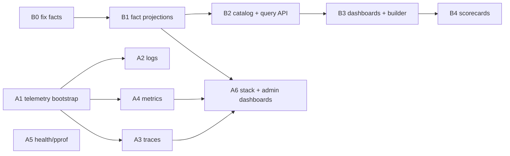

# Observability and run analytics (TODO 23) — plan

Status: proposed (2026-11-01). Splits TODO 23 into two products with two
audiences:

| | A. Platform observability | B. Run analytics |
|---|---|---|
| Audience | instance admin / operator | every user, on their own runs |
| Question | "is the platform healthy, where does it break, what gets used?" | "which flow / skillset / model is best for my tickets, and how do I improve it?" |
| Signals | OTel traces, logs, metrics | per-run and per-attempt facts in Postgres |
| Surface | Grafana (outside the app) | CPUI `/analytics` (inside the app) |
| Tenancy | aggregate, IDs only, no user content | `user_id = me`, always |

Both feed from the same run event stream; neither changes how runs execute.

## What exists today

- **Telemetry** (`internal/engine/telemetry/telemetry.go`): an `EventSink`
  projection of the run stream. One span per run, one per stage attempt, four
  metrics (`apothecary_runs_total`, `_pings_total`, `_stage_cost_usd`,
  `_stage_turns`). Enabled only by `APOTHECARY_OTEL_ENDPOINT` (insecure gRPC).
  No global provider, no propagation, spans start from `context.Background()`.
  The run span carries the raw ticket title (`:142-146`).
- **No** HTTP/DB/outbound instrumentation (`otelhttp` is indirect only), no
  `/metrics`, `/healthz`, pprof, request IDs, request logging, recovery
  middleware. `routes.go:126-163` is a bare `ServeMux` + `guard`.
- **Logging**: `slog.Default()` unconfigured (`main.go:161`), ad-hoc keys, no
  `run_id` convention, no trace correlation. The gateway uses `log.Printf`.
- **`observability/` stack**: collector + Prometheus + Grafana, all `:latest`.
  Traces go to the `debug` exporter (not stored), no logs pipeline. The three
  dashboards are broken: datasource UIDs `factory-*` vs provisioned
  `apothecary-*`, Postgres datasource has no password, `unwanted-pings.json`
  filters on ping types that no longer exist (`plan_approval`,
  `final_review`).
- **Analytics data**: everything is in `events.payload` jsonb. `runs` has
  `flow_name`, `flow_hash`, `state`, `user_id`; `ticket_id`, change type,
  skillsets, `started_by` live only inside `runs.view`. No analytic indexes.
  `listRuns` filters in Go (`httpapi/runs.go:27-63`). The UI sums cost/turns
  per run in the browser (`cpui/src/lib/run/derive.ts:22-35`,
  `runfacts.svelte.ts`). No chart library (`ResourceGraphs.svelte` is
  hand-rolled SVG).

### Data defects to fix first (they poison every chart)

1. **Failed attempts lose their spend.** `failAttempt`
   (`internal/engine/stage_agent.go:359-364`) appends `StageFailed` without
   `res.r.Usage`/`TurnsUsed`, although they are in hand at `:281`. Budgets
   (`runcore/state.go:548-550`) under-count too. A flow that retries a lot
   looks *cheaper* than it is.
2. **`stage_completed.duration_ms` resets on re-entry** (`started :=
   x.e.clock()`, `stage_agent.go:77`) and includes in-process waiting.
3. **Abandoned / failed runs get no totals**; only `run_completed` carries
   `total_cost_usd`, `total_turns`.
4. **Cost is harness-reported only.** Codex reports `0`
   (`IMPLEMENTATION_NOTES.md:546`); non-USD cost is dropped
   (`workspace/shim/acp.go:1275`). `0` and "unknown" are indistinguishable.

## Decisions

1. **User analytics are built in the app, not embedded.** Researched options:

   | Option | User-built dashboards | Tenant isolation | Fit |
   |---|---|---|---|
   | Metabase OSS | no — guest embeds of *fixed* dashboards only; query builder + row security need Pro ($575/mo + $12/user) or Enterprise ([Metabase, 2026-10](https://www.metabase.com/articles/build-or-embed-customer-analytics)) | locked JWT param | extra JVM service + own Postgres |
   | Superset | embedded SDK views dashboards only; building needs a Superset account ([docs](https://superset.apache.org/user-docs/using-superset/embedding)) | guest token + RLS rules | Python service + Redis |
   | Grafana | per-org editing, iframe embed needs auth proxy + org-per-user | DB role / RLS per org | a second UI with its own look and auth |
   | Cube / semantic-layer service | headless, still need our own UI | in query rewrite | extra Node service |
   | **In-app semantic layer** | yes | one Go choke point injects `user_id` | no new process (architecture decision 1, `clean-architecture-plan.md:17`) |

   The dimensions are a small, known catalog (flows, skillsets, stages,
   models, pings); the hard part is *correct facts*, which no BI tool gives
   us. A whitelisted query API over two projection tables plus a Svelte
   builder is the smaller, safer system. Grafana stays the admin's tool.
2. **Analytics facts are run projections.** They follow the existing rule
   (`pgstore.projectTx`, `RebuildProjections`): folded from events in the
   append transaction, rebuildable, never FK'd. Adding the migration
   triggers a full rebuild, so history back-fills for free.
3. **Telemetry carries IDs, numbers and enums — never user content.** No
   ticket titles, goals, prompts, answers, file paths. `user_id` is the
   opaque UUID. This keeps "admin grants no view into other users' work"
   (`auth.go:41`, `user.ts:13`) true in spirit: the admin sees *that* run
   `r_…` of user `u_…` failed with `output_invalid` on stage `review`, not
   what it was about.
4. **Standard OTel config.** Honour `OTEL_EXPORTER_OTLP_*`, `OTEL_SERVICE_NAME`,
   `OTEL_RESOURCE_ATTRIBUTES`, `OTEL_TRACES_SAMPLER`; remove
   `APOTHECARY_OTEL_ENDPOINT` (clean cutover: env.go, Helm
   `engine.otelEndpoint`, README).

## A. Platform observability (admin)

### A1. Telemetry bootstrap — `internal/platform/telemetry`

- Move provider setup out of `internal/engine/telemetry` into a platform
  package: global `TracerProvider`, `MeterProvider`, `LoggerProvider`,
  W3C propagators, OTLP (gRPC or HTTP per `OTEL_EXPORTER_OTLP_PROTOCOL`),
  resource with `service.name`, `service.version` (build info),
  `deployment.environment`. Shutdown flush stays in `wire.go`.
- With no endpoint configured: no-op providers (zero cost), as today.
- `internal/engine/telemetry` keeps only the event-stream projection and
  takes `trace.Tracer` / `metric.Meter` from the platform package.

### A2. Logs

- `slog` handler built at boot: `APOTHECARY_LOG_FORMAT=json|text`,
  `APOTHECARY_LOG_LEVEL`. Fan-out handler: stderr + OTel logs bridge
  (`go.opentelemetry.io/contrib/bridges/otelslog`, new dep).
- Context handler adds `trace_id`, `span_id`, and the fixed keys
  `run_id`, `project_id`, `user_id`, `stage_id`, `request_id` when present on
  `ctx`. One key vocabulary in `platform/logkeys`; adapters stop inventing
  keys.
- Gateway (`workspace/gateway/main.go`) moves to `slog` JSON; it runs in the
  workspace, so its logs reach the engine via the existing audit file path
  only — stdout JSON is enough for `docker logs`/Loki.

### A3. Traces

- **HTTP**: `otelhttp.NewHandler` around the mux, span name = route pattern
  (from the `Route` table, never the raw path), plus a request-ID middleware
  (`X-Request-Id` in/out) and panic recovery that logs + 500s. Attributes:
  route, status, `user_id`, access level. SSE/websocket routes record
  only setup, not the stream lifetime.
- **Run traces survive restarts**: derive the trace ID deterministically from
  `run_id` (hash → 16 bytes) so a recovered run continues the same trace
  instead of the lazily-started orphan span (`telemetry.go:118`). The HTTP
  request that created the run gets a span *link* to it.
- **Stage attempt spans** become parents of the work they cause: workspace
  provisioning, image pull/build, git operations, sidecar polling, harness
  invocation, tracker/VCS calls (`otelhttp.NewTransport` on the
  GitLab/GitHub/Jira/provider clients), egress policy pushes.
- **DB**: pgx `QueryTracer` hook (hand-written ~60 lines, or
  `github.com/exaring/otelpgx` — dep decision) — span per query with the
  statement *name*, not parameters.
- **GenAI**: stage attempt spans use OTel GenAI semconv attributes
  (`gen_ai.provider.name`, `gen_ai.request.model`, `gen_ai.usage.input_tokens`,
  `gen_ai.usage.output_tokens`, `gen_ai.agent.name` = agent, plus
  `apothecary.agent_hash`) ([semconv-genai](https://github.com/open-telemetry/semantic-conventions-genai/blob/main/docs/gen-ai/gen-ai-agent-spans.md)).
- Drop `apothecary.ticket` (title). Add `apothecary.project_id`,
  `.user_id`, `.ticket_id`, `.flow_hash`, `.ticket_change_type`,
  `.started_by`, skillset `name@seq`.

### A4. Metrics

Labels stay low-cardinality (no run/ticket/user IDs on metrics; those live in
traces and logs).

| Area | Instruments |
|---|---|
| HTTP | `http.server.request.duration` (route, method, status) via otelhttp |
| Go runtime / process | `go.opentelemetry.io/contrib/instrumentation/runtime` |
| DB | pgxpool `Stat()` as observable gauges (acquired, idle, wait count/duration); event append latency; projection rebuild duration |
| Engine | gauges: runs by state, queued runs, capacity slots used/total, live envs; histograms: queue wait, provisioning time, stage attempt duration (stage, harness, model, outcome); counters: stage failures by `reason`, edges taken by kind, budget stops |
| LLM | `gen_ai.client.token.usage` (type=input/output, model, harness), cost counter (model, harness), "cost unknown" counter |
| Humans | pings raised by type, ping answer latency histogram, holds taken |
| Workspace | egress denials (host class, not host), gateway up, sidecar poll errors |
| Integrations | tracker/VCS call duration + errors by integration kind |
| Feature usage | flow language features in use (step kinds, actions, `include`, `run_if`, blocks) counted from saved flows on a slow ticker; automations by trigger; harness/model popularity; UI-route hits come from the HTTP metric |

The last row is the "find new feature ideas" signal: what flows actually use,
where they fail, which models people pick — aggregate only.

### A5. Health and profiling

- `/healthz` (process up) and `/readyz` (DB ping, migrations done, not
  rebuilding) as `AccessPublic` routes; Helm probes move off
  `/api/auth/status`.
- pprof on a separate loopback listener, `APOTHECARY_DEBUG_ADDR` (off by
  default).

### A6. Stack and admin dashboards

- Replace `observability/docker-compose.yaml` with pinned images: either the
  single `grafana/otel-lgtm` image (collector + Prometheus + Tempo + Loki +
  Grafana) or pinned collector + Tempo + Loki + Prometheus + Grafana. Keep the
  unusual loopback ports (`IMPLEMENTATION_NOTES.md:271-276`).
- Collector: traces → Tempo, logs → Loki, metrics → Prometheus; exemplars on
  histograms so a slow stage links to its trace.
- Fix datasource UIDs, Postgres password (`secureJsonData` from env), stale
  ping types. Rewrite the Postgres panels on top of the new fact tables (B1)
  instead of jsonb.
- Admin dashboards: **Platform** (RED per route, DB pool, runtime),
  **Engine** (runs by state, queue, capacity, provisioning, failure reasons),
  **LLM spend** (tokens/cost by model and harness, unknown-cost share),
  **Humans** (ping volume/latency by type), **Usage** (feature usage table
  above), **Logs/Traces** explore links.
- Helm: optional `otel.endpoint`/headers values rendered as `OTEL_*`; no
  bundled collector (operators bring their own).
- In-app: admins get a `System › Observability` link (Grafana URL from
  settings) — no in-app admin charts.

### A7. Later (not in this TODO)

Harness-native telemetry (Claude Code / Codex emit their own OTel with
per-LLM-call detail) relayed through the shim → engine → collector. Blocked
by the egress filter today and doubles the GenAI data; revisit after A3.

## B. Run analytics (users)

### B0. Fix the facts

- `StageFailed` gains `TurnsUsed` and `Usage` (from `res.r.Usage` in
  `failAttempt`'s caller); `runcore` banks them, so budgets become correct
  too. Old events decode with zero usage — honest "unknown".
- `event.Usage.CostUSD` becomes "known" vs "unknown": add `CostKnown bool`
  (or pointer) so Codex runs render "—", not `$0.00`, and averages exclude
  them instead of dragging to zero.
- Durations are computed by the fold from event timestamps (below), not from
  `duration_ms`.

### B1. Fact projections

Extend the run fold (`run.Apply` / `runcore` state) with an analytics
accumulator, and write it in `projectTx`. Three tables, all user-scoped,
all in the `RebuildProjections` TRUNCATE list:

**`run_facts`** — one row per run (updated as the run progresses):

| Group | Columns |
|---|---|
| Keys | `run_id`, `user_id`, `project_id`, `ticket_id`, `automation_id` |
| Dimensions | `flow_name`, `flow_hash`, `ticket_change_type`, `ticket_source_type`, `tracker_kind`, `started_by` (human/automation), `state`, `end_reason` (abandon edge / fail reason), `retry_of` (try-again chain), `created_at`, `ended_at` |
| Time (ms) | `wall`, `queued`, `provisioning`, `agent_active`, `waiting_human` (pending pings, `ask_human` pauses, parked phases), `held` (takeovers), `paused` (user pause) |
| Spend | `cost_usd`, `cost_known`, `input_tokens`, `output_tokens`, `turns`, `ask_cost_usd` (ask pane, `ask_messages`) |
| Work | `stages_run`, `attempts`, `failed_attempts`, `retries` (`edge_taken` on_fail/on_reject/on_timeout), `rework_cost_usd` (spend in iterations > 1) |
| Humans | `pings`, `pings_wanted`, `pings_unwanted`, `gates_rejected`, `human_response_ms` (sum), `holds` |
| Outcome | `mr_opened`, `mr_merged` (when the flow observes it), `first_pass` (completed, no retries, no unwanted pings), `egress_denials` |

**`run_skillsets`** — `(run_id, user_id, skillset_id, name, seq, hash)`;
a run pins several skillsets, so this is its own grain.

**`stage_attempts`** — one row per `stage_started`: `run_id`, `user_id`,
`stage_id`, `iteration`, `harness`, `model`, `agent`, `agent_hash`,
`outcome` (completed / failed / paused / skipped / abandoned),
`failure_reason`, `started_at`, `ended_at`, `active_ms`, `waiting_ms`,
`cost_usd`, `cost_known`, tokens, `turns`, `pings` by kind.

Pings already have their own table (`type`, `stage_id`, `raised_at`,
`answered_at`, `answer`) — used as-is as the fourth grain.

Indexes: `(user_id, created_at)`, `(user_id, flow_name, flow_hash)`,
`(user_id, ticket_id)` on `run_facts`; `(user_id, stage_id, model)` on
`stage_attempts`.

Flow version labels: `flow_versions` is keyed by hash; the catalog derives
`v{n}` per `(project_id, name)` by `created_at`. Built-in flows (no row)
show `built-in@{hash[:7]}`.

### B2. Semantic layer + query API — `internal/analytics`

Plain hexagonal package (declares its `Store`, `pgstore` implements it,
contract tests in `analytics/analyticstest`, archtest rule, assertion in
`wire.go`).

- **Catalog** (Go, versioned): per grain, the allowed *dimensions*
  (column, label, type, time-bucketable) and *measures* (expression, allowed
  aggregations: count, sum, avg, median, p90, min, max, rate). Derived
  measures: `success_rate`, `cost_per_success`, `unwanted_pings_per_run`,
  `attempts_per_stage`, `runs_per_ticket`, `cost_to_ship` (all runs of a
  ticket until its first success), `human_minutes_per_run`.
- **Query** (JSON): `{grain, measures[], group_by[], filters[], time:
  {field, bucket, range}, compare: {dimension, values[]}, order, limit}`.
  The compiler maps names through the catalog only — no client SQL, ever —
  emits parameterised SQL, and **always** prepends `user_id = $me`.
  This one function is the tenancy boundary and gets the heaviest tests.
- Each result row carries `n`; groups with `n < 5` are flagged so a
  "flow #2 is 2× faster" built on three runs reads as noise.
- Routes (`httpapi/analytics.go`, `AccessUser`, `ScopeOwner`):
  `GET /api/analytics/catalog`, `POST /api/analytics/query`,
  `GET|POST|PUT|DELETE /api/analytics/dashboards[/{id}]`,
  `GET /api/analytics/dashboards/builtin`. `listRuns` gains the run facts
  (cost, wall time, attempts) so the run table stops fetching every run's
  events (`runfacts.svelte.ts`).

### B3. Dashboards

- **Storage**: `analytics_dashboards(id, user_id, name, panels jsonb,
  created_at, updated_at)` — ordinary CRUD, not a projection. A panel is
  `{title, query, viz, layout}`.
- **Built-in dashboards** ship as embedded JSON (like built-in flows),
  read-only, "Duplicate to edit":
  1. **Overview** — runs/week, success rate, median wall time, total spend,
     unwanted pings per run, trend lines.
  2. **Compare flows** — pick 2+ flow versions: median/p90 wall time,
     median cost, attempts, human pings, success rate, side by side with
     `n`. ("flow #1 median 15 min, flow #2 7 min".)
  3. **Compare skillset versions** — same, on `run_skillsets`.
  4. **Stages** — where time and money go: cost and time per stage, retry
     heatmap (stage × iteration), failure reasons, model per stage.
  5. **Humans** — pings by type and stage, response latency, gate reject
     rate, takeovers.
  6. **Tickets** — runs per ticket, cost to ship, by change type and source
     type.
- **Builder** (`cpui/src/lib/analytics`, new LAYERS entry, nav item
  `analytics`, `to.analytics()`): pick grain → measures → group by →
  filters → viz (number, table, bar, line, scatter cost-vs-time, heatmap,
  box plot). Drill-through: a bar → the filtered run list. CSV export of any
  panel.
- **Charts**: one dependency, `layerchart` 2.x (Svelte 5 runes, no Tailwind,
  colours via CSS variables so `check-tokens` holds) instead of hand-rolling
  box plots and heatmaps. Needs sign-off under the no-new-deps rule.

### B4. Scoring (opt-in)

"Best" is the user's call, so a **scorecard** is just saved weights:

- `analytics_scorecards(id, user_id, name, terms jsonb)`; a term is
  `{measure, direction: lower|higher, weight}` — e.g. cost ↓ 0.3, wall time
  ↓ 0.3, unwanted pings ↓ 0.2, success rate ↑ 0.2.
- Score of a group = Σ weight × normalised measure, normalised within the
  compared set (min-max) or against a chosen baseline group (ratio). It is
  exposed as a measure, so any table can rank flows/skillsets by it.
- Built-ins: "Cheapest", "Fastest", "Least hands-on", "Balanced".
- Caveat shown in the UI: speed and cost without an outcome term reward
  flows that give up early; every built-in scorecard includes success rate.

## Phases

Tracks A and B are independent until A6 (admin Postgres panels read B1's
tables). B0 lands first: every later number depends on it.

## Verification

- B0: engine test — a failed attempt's usage reaches `StageFailed` and the
  budget fold.
- B1: fold tests — live fold and rebuild produce identical `run_facts` /
  `stage_attempts`; time buckets sum to wall time; fixtures for retry,
  takeover, park, pause, try-again, abandoned.
- B2: compiler tests — unknown field rejected, `user_id` predicate present in
  every emitted query, cross-user rows never returned (contract test with
  two users), `n` and small-`n` flag.
- A: run the stack, run a flow, see the run trace in Tempo with HTTP → run →
  stage → harness/DB/tracker spans, logs in Loki joined by `trace_id`, every
  dashboard panel returning data.
- UI: builder and built-ins against seeded runs in the browser.

## Open questions

1. **Admin cross-user visibility.** Decision 3 keeps telemetry to IDs and
   numbers. Should admins *also* get the user analytics UI across all users,
   or is Grafana-only correct?
2. **Chart dependency.** `layerchart` vs keep hand-rolled SVG (more code,
   no box plot/heatmap for free).
3. **Cost when the harness reports none.** Show "unknown" (this plan), or add
   a model price catalog to estimate from tokens (more accurate, one more
   table to keep current)?
4. **Observability stack image.** Single `grafana/otel-lgtm` (simplest dev
   story) vs separate pinned components (closer to production).
5. **Outcome signal for scoring.** `mr_merged` needs a flow to observe the
   merge (`wait_merge`); flows without it only have run state. Is that enough,
   or do we want an explicit user rating per run (thumbs up/down)?
