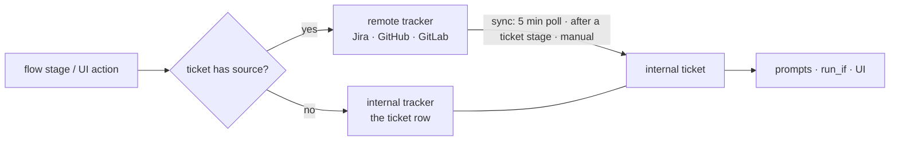

# Tickets that follow their tracker (TODO 49) — plan

Status: built (2026-11-01). Where the build differs from this plan (GitLab's
type list, backoff and error handling, where the refreshes run, GitHub's
FetchMany through GraphQL) is recorded in docs/notes, "Tickets
follow their tracker (TODO 49)". Reverses the
"a copy taken once" decision in docs/notes ("Ticket sources") and
narrows the "a ticket without a source skips" rule from TODO 27 ("Tracker
actions").

## Why

- An internal ticket is a **one-time copy** today (`tickets.Factory.CreateFromSource`):
  title, body, type and attachments are read once and never fetched again.
- An internal ticket has **no status, labels or comments**
  (`confstore.Ticket`, `0001_init.sql:95`). The "status" the UI shows is the
  latest run's state (`fleet.runsByTicket`).
- Every `ticket_*` action writes **only to the remote issue**
  (`internal/engine/ticket.go`). A hand-written ticket has no issue, so
  `runcore.StageCondition` (`routing.go:122-128`) and `(*exec).tracker` skip
  the stage. Without Jira, nothing ever moves to done.
- Agents see the title, change type, goal, run goal and attachments
  (`engine/prompt.go` `ticketSection`). They never see status, labels or
  comments.

## The model

**Every ticket has exactly one tracker: the remote issue if it has a source,
otherwise Apothecary itself. Every write goes to that tracker, and the
internal ticket only ever *reads* from it.**

- **A sourced ticket is a mirror.**
  - The remote owns title, body, status, type, labels and comments, and every
    sync overwrites them.
  - The user cannot edit those fields in Apothecary.
  - A write goes to the remote and is followed by a refresh of that one
    ticket. Nothing is written to both sides.
- **A sourceless ticket uses the internal tracker.** This covers hand-written
  tickets and MR tickets (`source_kind = merge_request`, no `source_id`).
  Writes land on the row, and sync does nothing.
- Writing to both sides was rejected because the two would drift: as soon as
  one write fails, a human moves the issue in Jira, or a Jira workflow refuses
  a transition. With the remote as the single source of truth, the only cost is
  sync latency (G1).

## Decisions

1. **The internal tracker is an adapter behind the same port.**
   - It lives in `internal/project/tickets/internaltracker`, implements
     `trackerport.TicketWriter`, and is backed by confstore.
   - `Resolution.TicketWriter(ctx, integrationID)` becomes
     `Resolution.TicketTracker(ctx, ticketID)`. It returns the remote writer
     when `source_id` is set, otherwise the internal one.
   - The engine keeps going through `project/resolution`, so the archtest
     layering is unchanged.
2. **The tracker is resolved from the *current* ticket row, not the run
   snapshot.**
   - `RunCreated` keeps the `TicketSource*` copy for display.
   - The run's writes follow the ticket. If the ticket is unlinked mid-run
     (G10), the run's next `ticket_transition` lands on the internal tracker.
     It never writes to a deleted integration.
3. **Statuses and types live on the integration.** Each ticketsource
   integration has its own lists, and so does the internal tracker:
   - **Remote integration.** The lists are **fetched** from the remote and
     extended by sync (G7). The user does not invent names; they only set the
     columns below.
   - **Internal tracker.** Each user gets one built-in ticketsource integration
     of kind `internal`. It cannot be deleted, it is seeded on user creation,
     and its lists are **edited by the user**. Sourceless tickets resolve to it
     (`source_id` stays empty, so `run.ticket.tracker` keeps meaning "has a
     remote tracker").
   - GitHub and GitLab issues expose two statuses, `open` and `closed`, and
     that is all the mirror shows. There are no label-backed statuses.
4. **Each status row has two user-set columns.**

   | column | meaning |
   |---|---|
   | **Done** (checkbox, any number of rows) | the work is over. The poll skips tickets in a done status (§ Sync). The UI may hide them by default |
   | **Flow step** (`todo`/`in_progress`/`in_review`/`done`/`blocked`, or none; each step used at most once per integration) | the status that `ticket_transition to: <step>` moves to. A step with no status → the stage skips with a note, as today's `ErrStatusUnsupported` does |

   - The flow-step set stays a closed enum, so `builder.yaml`,
     `actionspec.Statuses`, the parser enum tests and flow portability are
     untouched.
   - `status: "<name>"` (free text) keeps addressing an exact status on
     either tracker.
   - The two columns are independent: "Done", "Won't do" and "Duplicate" can
     all be done while only "Done" is the `done` step. Saving warns, without
     refusing, when the `done` step's status is not checked done.
   - **Auto-suggest on fetch:**
     - Jira: `statusCategory=done` → Done checked. Category `new` → the
       `todo` step and category `done` → the `done` step, each if the step is
       still free.
     - GitHub/GitLab: `closed` → Done checked and the `done` step; `open` →
       the `todo` step.
5. **Each type row maps to one change type.**
   - `ChangeType` (`feat/fix/hotfix/perf/docs/chore`) stays closed. It drives
     branch names (`BranchName`), `run_if: run.ticket.change_type` and the
     inspector.
   - Remote types are fetched. `GuessChangeType` only pre-fills a new row.
   - This replaces Jira's free-text `type_map`, just as decision 4 replaces
     `status_map`. Both config fields are removed (clean cutover).
6. **One active run per ticket** (§ Concurrency).
7. **Comments reach prompts only when a stage opts in** (§ Prompts).

## Concurrency

Two runs on one ticket write conflicting *meanings*, not corrupt rows. Run A
merges and moves the ticket to done; run B's merge request is then closed, and
B's `closed` outcome moves the same ticket back to todo. Last write wins, and
the ticket ends up wrong.

**Rule: a ticket has at most one non-terminal run.**
- Non-terminal means `pending`, `provisioning`, `running`,
  `waiting_on_human`, `in_review` or `paused` (`run.State.Terminal`).
  Completed, failed or abandoned runs do not count.
- Runs without a ticket (`TicketID == ""`) are exempt.

| where | behaviour |
|---|---|
| `Engine.CreateRunWith` | refuses with `ErrTicketBusy{RunID}`. The check runs under an engine per-ticket lock that is held until `RunCreated` is appended, so two concurrent starts cannot both pass. It is not a DB unique index: the projection is rebuilt from the event log, and older history may violate it |
| `startTicketRun` (HTTP) | 409 naming the active run. The UI turns "Start run" into "Run X is active — open / abort" |
| `Rerun` | same rule. A rerun of a finished run is refused while another run of the ticket is active |
| cron automation (`tick`) | a fire on a busy ticket is **skipped**: `last_error = "ticket busy: run X"`, no catch-up (the same policy as missed slots) |
| `tracker_query` / MR automations | unaffected. Each import or MR has its own ticket, and `ticketForMR` already refuses a ticket that has runs |

Cost of the rule:
- A run waiting `in_review` for days blocks a new attempt on its ticket. To
  start a new attempt, the user aborts the old one, which is also what keeps
  its `closed` outcome from moving the ticket back.
- Parallel attempts on one ticket (different flows or models) are no longer
  possible.

Writers that remain after the rule:
- the active run, the sync, the user in the Apothecary UI, and humans in the
  remote tracker;
- the sync is serialized per ticket (single-flight in `Syncer`) and guarded by
  `remote_updated_at` (G1);
- internal-tracker writes are single SQL statements: status set, label
  union/replace in SQL, comment insert. That makes a run and a user editing at
  once safe, with last write wins on status, which is intended because both
  writers mean it.

## Data model (migration `0021_ticket_tracker.sql`)

`0001` is frozen, so everything below is additive and re-runnable. The product
is pre-1.0, so there is no carry-over of hand-edited goals (G3).

| table / column | purpose |
|---|---|
| `tracker_statuses(id, integration_id FK cascade, remote_id, name, remote_category, position, is_done, flow_step)` | per-integration status list. Unique `(integration_id, remote_id)` (for the internal tracker `remote_id = id`) and `(integration_id, flow_step) WHERE flow_step IS NOT NULL` |
| `tracker_types(id, integration_id FK cascade, remote_id, name, change_type, position)` | per-integration type list |
| `tickets` + `status_id FK tracker_statuses, type_id FK tracker_types, labels text[]` | the ticket's state, which must belong to the ticket's tracker. `change_type` stays a column derived from the type, so `run_if`, branch names and the list query don't need a join |
| `tickets` + `remote_id, remote_updated_at, synced_at, sync_state, sync_error` | stable remote id (Jira keys change on a move) and sync bookkeeping. `sync_state ∈ ok\|error\|gone` |
| `ticket_comments(id, ticket_id, remote_id, author, body_md, created_at, updated_at, origin, run_id, stage_id)` | `origin ∈ remote\|user\|apothecary`. Unique `(ticket_id, remote_id)` and `(ticket_id, run_id, stage_id)`: the internal tracker's idempotency key, which replaces trailer scanning there |
| `ticket_links(ticket_id, url, title)` | lets `ticket_link` / `ticket_link_branch` land on internal tickets. Upsert on URL |
| unique `tickets(user_id, source_id, lower(source_key)) WHERE source_id <> ''` | replaces the O(n) `checkDuplicate` / `FindByKey` scans. The migration fails loudly on existing duplicates rather than dropping rows |

The migration also:
1. creates each existing user's `internal` integration, seeded with To do
   (`todo`), In progress (`in_progress`), In review (`in_review`), Done
   (`done`, done ✓) and Blocked (`blocked`), plus one type per change type;
2. sets `status_id` / `type_id` on sourceless tickets: To do, and the type
   matching `change_type`;
3. turns each Jira integration's `status_map` / `type_map` into status/type
   rows (with `remote_id` filled on the first metadata fetch), then deletes
   those config keys;
4. leaves sourced tickets with `status_id` NULL until their first sync, which
   the daemon runs at boot. The UI shows "not synced yet".

Confstore follow-ups:
- `conftest.fullTicket` / `allSet` (a reflection check that forces every new
  field to be covered) and the `mem.go` store;
- pgstore `ticketCols` / `scanTicket`;
- new queries `TicketBySource`, `ListSyncable(integrationID)` (not done, not
  gone) and `ListTicketsBySource(integrationID)`.

## Port changes (`internal/ports/trackerport`)

| change | why |
|---|---|
| `SourceTicket` + `RemoteID, Labels []string, StatusID` (the remote status id) | labels are already decoded and then dropped (GitHub `issueJSON.Labels`, GitLab `Labels`); Jira needs `labels` added to `issueFields` |
| `Comments` → `ListComments(key) []Comment{ID, Author, Body, Created, Updated}` | sync needs identity and order. The `actionTicketComment` reconcile moves to it |
| new optional `TicketMetadata{Statuses(ctx) []RemoteStatus{ID, Name, Category}; Types(ctx) []RemoteType{ID, Name}}` | fills the lists. Jira: `/status` (with `statusCategory`), `/issuetype`. GitHub/GitLab: fixed `open/closed`, type `issue` |
| new optional `TicketSyncer{FetchMany(ctx, keys) ([]SourceTicket, error)}` | batched poll. Jira: JQL `key in (…)` (≤100). GitHub: one `issues?since=` per repo. GitLab: `iids[]=` |
| `TicketStatus` renamed `FlowStep` | it names a flow step now, not a status. Rename in `actionspec` too; the equality test stays |
| `TransitionTo(key, step)` removed from adapters | the internal tracker resolves step → status name from `tracker_statuses`, then calls `Transition(key, name)`. Adapters stop holding status maps (`jira.DefaultStatusMap`, `issueStatusMap`) |

Adapters to update: Jira, GitHub issues, GitLab issues, and the fake
(`fake.go:1128+`, which needs `Statuses`, `Types`, `FetchMany` and comment
ids).

## Write path

1. `(*exec).tracker` calls `Resolution.TicketTracker(ctx, View.TicketID)`.
   `View.TicketID` is already in `RunCreated`.
2. `StageCondition` stops auto-skipping `RequiresTracker` actions, because
   every ticket now has a tracker. `run.ticket.tracker` keeps meaning "has a
   remote tracker", so flows that guard on it behave as before.
3. Internal tracker semantics:

| action | internal tracker |
|---|---|
| `ticket_transition to: <step>` | set `status_id` to the status holding that step. Already there → no-op. No status holds the step → skip with a note |
| `ticket_transition status: <name>` | lookup by name. Missing → `ErrStatusUnreachable{Reachable: names}` → `input_invalid` |
| `ticket_comment` | insert `origin=apothecary`, keyed `(run_id, stage_id)` |
| `ticket_set_field field: labels` | replace or union on `labels`, in SQL |
| `ticket_set_field` any other field | **skip with a note**, not `input_invalid` (G9) |
| `ticket_link` / `ticket_link_branch` | upsert into `ticket_links` |
| ticket deleted mid-run | `ErrTicketGone` → skip with a note |

4. The remote tracker is unchanged, except that step → status name now comes
   from `tracker_statuses`. After a successful remote write the stage
   refreshes the ticket (§ Sync). A refresh failure never fails the stage.
5. The UI uses the same port to change status, labels and comments: on a
   sourced ticket the change goes to the remote and then refreshes; on a
   sourceless ticket it goes to the row. Title and body stay read-only on
   sourced tickets.

## Sync

`tickets.Syncer` provides `Refresh(ticketID)`, `RefreshIntegration(id)` and
`RunOnce()`. It is single-flight per ticket. One pass:
1. calls `FetchMany` (or `Fetch` per key when the capability is missing),
   then `ListComments`;
2. resolves status and type by remote id against the integration's lists;
3. writes the row and reconciles comments by `remote_id` (insert, update, and
   delete the ones that are gone).

| trigger | scope | skips done? |
|---|---|---|
| poll every 5 min (a ticker in `cmd/apothecaryd/background.go`, beside the automation watcher) | `ListSyncable`: sourced, **status not done**, not `gone` | **yes** |
| after each ticket stage (any stage whose action is `ticket_*`) | that run's ticket only | no |
| before an agent stage with a `run.ticket.comments` input | that run's ticket only, so the prompt is fresh | no |
| when a run starts on the ticket (`CreateRunWith`) | that ticket only. This trigger was not in your list; it is the one moment a done ticket's mirror (e.g. reopened in Jira) matters | no |
| manual: `POST /api/tickets/{id}/sync`, `POST /api/integrations/{id}/sync`, Refresh buttons | the ticket, or every ticket of the integration **including done ones** | no |

Behaviour around the done flag:
- **Done is a read-side filter.** Unchecking Done on a status puts its tickets
  back in the poll at the next pass, and checking it takes them out.
- **A ticket reopened remotely while done** is only noticed by a manual
  refresh or a run start. This is the price of not polling done tickets.

Error handling:
- **Monotonic guard:** a fetched snapshot whose `Updated` is older than the
  stored `remote_updated_at` is dropped (G1).
- 401 or 403 → `sync_state=error` with backoff.
- 404 → retry by `remote_id` (handles a Jira move or a GitHub transfer),
  otherwise `gone`, which stops polling.
- 429 → honour `Retry-After`.

UI freshness: add tickets to the fleet poll (`fleet.svelte.ts`,
`POLL_MS = 4000`). It reads the DB, not the tracker. No ticket SSE stream is
needed.

## Integration UI and API

- `GET /api/integrations/{id}/statuses` and `/types` return the lists. A
  `?refresh=1` query refetches from the remote, following the `/repos` and
  `/models` pattern.
- `PUT /api/integrations/{id}/statuses` and `/types` set Done, the flow step
  and the change type on remote integrations. On the `internal` integration
  they also create, rename, reorder and delete rows.
  - Validated on save: each flow step is used at most once, and every type
    has a change type. Today's `status_map` is only checked when the adapter
    is built.
- In `IntegrationForm.svelte`, the ticketsource kinds get a **Statuses** table
  (name · Done ☐ · flow step) and a **Types** table (name · change type). They
  replace the `status_map` / `type_map` text inputs.
- The internal integration's card has no Delete button.
- Ticket list: a status column and filter, and done tickets hidden by default.
  Ticket page: a status chip, labels, comments, a Refresh button and a "last
  synced" time.

## Deleting an integration

`source_id` is the integration's id and `source_kind` its kind (`jira`, …),
so tickets from two Jira integrations are told apart by `source_id`. The
column has no FK by design, which is why unlinking is explicit:
1. `DELETE /api/integrations/{id}` without `?unlink_tickets=1` → 409 with
   `{tickets: N, active_runs: M}`. The UI confirms: "N tickets will be
   unlinked and become Apothecary tickets."
2. With the flag, in one transaction:
   - clear `source_*` and `remote_*` on those tickets;
   - move each ticket to the internal tracker's lists:
     - status: same name, case-insensitive; else a done status → the
       internal `done` step; else the internal `todo` step;
   - type: by change type;
   - keep the comments, now `origin=remote` history;
   - delete the integration, which cascades its status and type rows.
3. Active runs on those tickets continue. Decision 2 sends their next tracker
   write to the internal tracker.

## Prompts

- New input source `run.ticket.comments` of type `ticket_comments`, modelled
  on `artifacts/threads.yaml` / `mr_threads`. **Opt-in per stage**, with:
  - a cap: `limit` (latest N, default 20) and a byte budget;
  - `exclude_own: true` by default, which drops `origin=apothecary` (the run's
    own bookkeeping).
- `ticketSection` additionally renders the key, status and labels.
- Comments are refreshed before the stage (§ Sync) and read at prompt-build
  time. Prompts are assembled per stage, so replaying the event log is
  unaffected.
- Comments are **untrusted input**: they are wrapped and labelled as quoted
  third-party text. This feeds TODO 43.

## Gaps and their fixes

| # | gap | fix |
|---|---|---|
| G1 | **Flip-flop.** Jira's search index lags, so a poll right after a stage moved the issue can return the old status | the post-stage refresh uses `Fetch` by key (consistent), not search. The monotonic `remote_updated_at` guard drops stale batches |
| G2 | **GitHub/GitLab expose only open/closed** | accepted: the mirror shows two statuses, and `to: in_progress` skips unless the user gives that step a status. No label-backed statuses |
| G3 | **Users can edit an imported ticket's title and goal today** | refused on sourced tickets (API 409 on `PUT` for remote-owned fields; UI read-only). The first sync overwrites earlier hand edits (pre-1.0, no carry-over). Per-attempt direction stays in the run goal |
| G4 | **`Rerun` copies the previous run's ticket** (`engine.go:1052-1066`) | `Rerun` rebuilds `runinput.Ticket` from the current row, after the run-start refresh |
| G5 | **Closed enums are duplicated in Go and TypeScript** (`CanonicalStatuses`, `actionspec.Statuses`, `CondChangeTypes`, `domain/ticket.ts`, `inspector.ts`) | they stay closed, as flow steps and change types. Only the lists are dynamic, and the UI reads them per integration |
| G6 | **Deleting an internal status or type that tickets use** | the delete takes a `replace_with` id from the same integration |
| G7 | **A remote status appears after the fetch** (a Jira workflow edit) or is renamed | sync upserts unknown remote statuses and types by `remote_id`, pre-filled by auto-suggest, and renames follow the id. A remote status that disappears keeps its row while tickets use it |
| G8 | **MR tickets** have `source_kind=merge_request` and no `source_id` | they use the internal tracker, so `ticket_done` in `builder.yaml` now really moves them. The sync query filters on `source_id <> ''` |
| G9 | **Sourceless runs now act** where they used to skip. A flow setting `components` on a hand-written ticket would turn a skip into `input_invalid` | the internal tracker returns a skip-class error for fields it lacks. The `builder.yaml` header (:61-69) and flow-language "Tracker actions" (:925-959) are rewritten |
| G10 | **Integration deleted** while tickets reference it | explicit unlink on delete (§ Deleting an integration). Runs follow the ticket (Decision 2) |
| G11 | **Remote key changes** (Jira project move, GitHub transfer) | `remote_id`; on a 404, re-resolve and rewrite `source_key` / `source_url` |
| G12 | **Rate limits** | `FetchMany` batching, `Retry-After`, and no polling of done or gone tickets |
| G13 | **O(n) scans** in `checkDuplicate` / `FindByKey` | a unique index plus `TicketBySource` |
| G14 | **New remote attachments** are never fetched | sync attachments by remote id (`Attachment.RemoteID`); phase 6 |
| G15 | **"Who moved this ticket?"** | `status_changed_at`, plus `status_changed_by` (`sync` · `run:<id>/<stage>` · `user`) |
| G16 | **Stale copy** says "a copy taken once; nothing is written back": `tickets.go` package doc, the `confstore.Ticket` doc, `domain/ticket.ts:20`, the ticket page :189, the kind help texts, README :145-221 (`0001` stays frozen) | rewritten in the phase that changes the behaviour |
| G17 | **`in_review` is both a run state and a flow step** | the UI shows the ticket's status *name* (from its tracker), never the step, and labels the run state as "Run: …" |
| G18 | **A human moves the issue mid-run** | out of scope. It needs the unbuilt tracker-status signal (`flow-language.md:2176-2179`), which sync makes cheap later |
| G19 | **Concurrent runs on one ticket** | one non-terminal run per ticket (§ Concurrency) |

## Phases

Each phase ships on its own and leaves no dead path.

1. **Lists and the internal tracker.**
   - Migration: `tracker_statuses` / `tracker_types`, the `internal`
     integration and its seeds, the new ticket columns, `ticket_comments`,
     `ticket_links`.
   - The `internaltracker` adapter; `Resolution.TicketTracker` from the
     current ticket row; remove the `StageCondition` auto-skip.
   - Internal-integration list editor, plus ticket status, labels and comments
     in the UI.
   - Docs: flow-language, `builder.yaml` header, docs/notes.
   - After this phase, TODO 49's "no tracker" half is done.
2. **One active run per ticket.** Engine rule, 409 + UI, cron skip, `Rerun`.
3. **Port and adapters.**
   - `SourceTicket` additions, `ListComments`, `TicketMetadata`,
     `TicketSyncer`, and the `FlowStep` rename.
   - Status maps move out of the adapters (Jira, GitHub, GitLab, fake).
4. **Remote lists.**
   - Fetch endpoints, the Statuses and Types tables with Done and flow-step
     columns plus auto-suggest.
   - Migrate and remove `status_map` / `type_map`.
5. **Sync.**
   - `Syncer`, the 5-minute loop skipping done tickets, post-stage /
     pre-comments / run-start refresh, manual endpoints and buttons.
   - Read-only remote fields, unlink-on-delete, `gone` handling; `Rerun` reads
     the current row.
   - README and the kind help texts.
6. **Prompts and extras.**
   - The `run.ticket.comments` input, and key, status and labels in
     `ticketSection`.
   - Attachment sync (G14).

Verification per phase:
- confstore conftest on both stores;
- engine tests on the fake tracker: internal vs remote resolution, the skip
  classes, comment idempotency on recovery, the busy-ticket refusal under
  concurrent `CreateRunWith`;
- sync tests: the done filter, the monotonic guard, 404 → `remote_id`, comment
  reconcile, unlink-on-delete;
- `TestCommittedSpecIsCurrent` after `task api:spec`;
- smoke: `builder.yaml` on a hand-written ticket ends with the ticket in Done
  and out of the poll.
