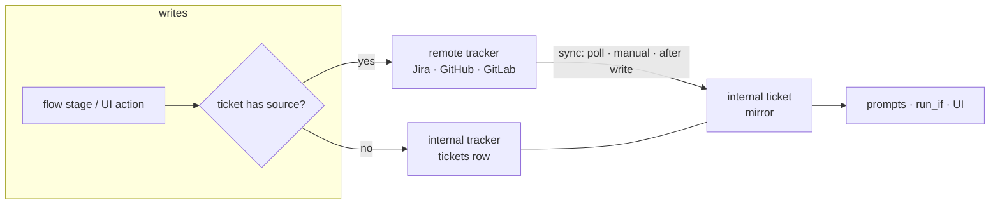

# Tickets that follow their tracker (TODO 49) — plan

Status: proposed (2026-11-01). Reverses the "a copy taken once" decision in
IMPLEMENTATION_NOTES ("Ticket sources", :1365) and narrows the "a ticket
without a source skips" rule from TODO 27 ("Tracker actions", :2577).

## Why

- An internal ticket is a **one-time copy** today (`tickets.Factory.CreateFromSource`):
  title, body, type and attachments are read once. Nothing is fetched again.
- An internal ticket has **no status, labels or comments**
  (`confstore.Ticket`, `0001_init.sql:95`). The "status" the UI shows is the
  latest run's state (`fleet.runsByTicket`).
- Every `ticket_*` action writes **only to the remote issue**
  (`internal/engine/ticket.go`). A hand-written ticket has no issue, so
  `runcore.StageCondition` (`routing.go:122-128`) and `(*exec).tracker` both
  skip the stage. Without Jira, nothing moves to `done`.
- Agents see only title, change type, goal, run goal and attachments
  (`engine/prompt.go` `ticketSection`). Status, labels and comments, which
  often carry context, are never shown to the agent.

## The model in one sentence

**Every ticket has exactly one tracker: the remote issue if it has a source,
otherwise Apothecary itself. Every write goes to that tracker, and the
internal ticket only ever *reads* from it.**

- **Sourced ticket.** It is a mirror. Title, body, status, type, labels and
  comments are owned by the remote and overwritten on every sync. A write goes
  to the remote and is followed by an immediate refresh of that one ticket,
  never a dual write.
- **Sourceless ticket.** This covers hand-written tickets and MR tickets
  (`source_kind = merge_request`, no `source_id`). The internal ticket *is* the
  tracker: writes land on the row directly, and sync is a no-op.
- Both paths sit behind the same port, so the flow, engine and UI code never
  branch on "remote or not".

Your reasoning holds. A dual write (remote + internal) drifts as soon as one
side fails, a human moves the issue in Jira, or Jira's workflow refuses a
transition. Sourcing the mirror from the remote gives one source of truth, and
the cost is the sync latency handled in § Gaps G1.

## Decisions

1. **An internal tracker adapter implements `trackerport.TicketWriter`.**
   Package `internal/project/tickets/internaltracker`, backed by confstore.
   - `Resolution.TicketWriter(ctx, integrationID)` becomes
     `Resolution.TicketTracker(ctx, ticketRef)`. It returns the remote writer
     when `source_id` is set, otherwise the internal one.
   - The engine keeps going through `project/resolution`, so the archtest
     layering is unchanged.
2. **Flows keep targeting fixed *categories*; users own the *statuses*.**
   - The canonical set `todo, in_progress, in_review, done, blocked` stays
     closed and becomes the **status category**. Every user-defined status
     belongs to exactly one category, and each category has one default.
   - `ticket_transition to: in_progress` therefore still parses against a
     fixed enum. `builder.yaml`, `actionspec.Statuses`, the parser enum tests
     and flow portability are untouched.
   - `status: "QA"` (free text) keeps addressing an exact status, now on
     either tracker.
   - Jira works the same way (status → statusCategory), which makes
     auto-mapping almost free.
3. **The same split applies to types.**
   - `ChangeType` (`feat/fix/hotfix/perf/docs/chore`) stays closed. It drives
     branch names (`BranchName`), `run_if: run.ticket.change_type` and the UI
     inspector.
   - User-defined **ticket types** (Bug, Story, Spike, …) each map to one
     change type. `GuessChangeType` remains only as the auto-suggest for an
     unmapped remote type.
4. **Statuses and types are a per-user catalog. The remote → catalog mapping
   lives on the integration.**
   - Integrations are already per user (`confstore.Integration.UserID`), and
     one Jira typically feeds several workshops. Mapping per (project,
     integration) would make users redo the same mapping for every repo.
   - "Workspace" in this codebase means the dev container, and "workshop" is
     the project. A board vocabulary is a team concept, not a repo concept, so
     it belongs to the user (the account; there is no org entity).
   - The alternative of per-project catalogs is listed in § Open questions.
5. **Mappings are fetched, not typed.** The free-text Jira `status_map` and
   `type_map` config fields are removed in a clean cutover and migrated into
   the mapping table. Adapters gain a metadata capability that lists remote
   statuses and types.
6. **Remote-owned fields are read-only locally on sourced tickets.**
   - Local-only fields stay editable: base branch, a new `notes` field (see
     G3), and an explicit change-type override.
   - Editing a status, label or comment from the UI goes through the tracker
     port, like a flow stage does.

## Data model (migration `0021_ticket_tracker.sql`)

`0001` is frozen, so everything below is additive and re-runnable.

| table / column | purpose |
|---|---|
| `ticket_statuses(id, user_id, name, category, position, is_default, color)` | user catalog. Unique `(user_id, lower(name))`. One `is_default` per `(user_id, category)` |
| `ticket_types(id, user_id, name, change_type, position, is_default)` | user catalog. Unique `(user_id, lower(name))` |
| `tracker_mappings(integration_id, kind status\|type\|label_status, remote_value, target_id, is_primary)` | remote → catalog. `is_primary` picks the outbound remote status per category (several remote statuses can map in, but only one is written out) |
| `tickets` + `status_id, type_id, labels text[], notes` | normalized mirror plus the local-only note |
| `tickets` + `remote_id, remote_status, remote_type, remote_updated_at, synced_at, sync_state, sync_error` | raw remote values (shown even when unmapped), a stable id (Jira keys change on a move), and the sync bookkeeping. `sync_state ∈ ok\|error\|gone\|orphaned` |
| `ticket_comments(id, ticket_id, remote_id, author, body_md, created_at, updated_at, origin, run_id, stage_id)` | `origin ∈ remote\|internal\|apothecary`. Unique `(ticket_id, remote_id)` and `(ticket_id, run_id, stage_id)` (the internal tracker's idempotency key, replacing trailer scanning) |
| `ticket_links(ticket_id, url, title)` | lets `ticket_link` / `ticket_link_branch` land on internal tickets. Upsert on URL, matching Jira's globalId semantics |
| unique `tickets(user_id, source_id, lower(source_key)) WHERE source_id <> ''` | replaces the O(n) `checkDuplicate` / `FindByKey` scans with a query. The migration must fail loudly on existing duplicates rather than drop rows |

The migration also:
- seeds every existing user's catalog with one status per category (To do,
  In progress, In review, Done, Blocked) and one type per change type;
- backfills `tickets.type_id` from `change_type`;
- sets `status_id = todo-default` on existing tickets (sync corrects sourced
  ones on the first pass);
- turns every Jira integration's `status_map` / `type_map` text into
  `tracker_mappings` rows, then deletes those config keys.

Confstore follow-ups: `conftest.fullTicket` / `allSet` (the reflection check
forces every new field to be covered), the `mem.go` store, the pgstore
`ticketCols` / `scanTicket`, and new queries `TicketBySource`,
`ListTicketsBySource(integrationID)` and `ListTicketsByProject`.

## Port changes (`internal/ports/trackerport`)

| change | why |
|---|---|
| `SourceTicket` + `RemoteID, Labels []string, StatusCategory` | labels are already decoded and dropped (GitHub `issueJSON.Labels`, GitLab `Labels`); Jira needs `labels` added to `issueFields` |
| `Comments` → `ListComments(key) []Comment{ID, Author, Body, Created, Updated}` | sync needs identity and order. `actionTicketComment` reconcile moves to it |
| new optional `TicketMetadata{Statuses(ctx) []RemoteStatus{Name, Category}; Types(ctx) []RemoteType{Name}}` | feeds the mapper. Jira: `/status` (with `statusCategory`), `/issuetype`. GitHub/GitLab: fixed `open/closed` plus labels |
| new optional `TicketSyncer{FetchMany(ctx, keys) ([]SourceTicket, error)}` | batches the poll: Jira JQL `key in (…)` (≤100), GitHub one `issues?since=` per repo, GitLab `iids[]=` |
| `TicketStatus` renamed `StatusCategory` | it is a category now. Rename in `actionspec` too; the equality test stays |

Adapters to update: Jira, GitHub issues, GitLab issues and the fake
(`fake.go:1128+`, which needs `Statuses`, `Types`, `FetchMany` and comment
ids).

## Write path

1. `(*exec).tracker` resolves `TicketTracker` from `View.TicketID` (already in
   `RunCreated`) plus the source fields.
2. `StageCondition` stops auto-skipping `RequiresTracker` actions, because
   every ticket now has a tracker. `run.ticket.tracker` keeps its meaning,
   "has a *remote* tracker", so flows that guard on it don't change behaviour.
3. Internal tracker semantics:

| action | internal tracker |
|---|---|
| `ticket_transition to: <category>` | set `status_id` to the category default. Already there → no-op. Category has no status → `ErrStatusUnsupported` → skip with a note (same as today's remote rule) |
| `ticket_transition status: <name>` | catalog lookup by name. Missing → `ErrStatusUnreachable{Reachable: names}` → `input_invalid` |
| `ticket_comment` | insert `origin=apothecary`, keyed `(run_id, stage_id)` |
| `ticket_set_field field: labels` | replace or append on `labels` |
| `ticket_set_field` any other field | **skip with a note**, not `input_invalid` (see G9) |
| `ticket_link` / `ticket_link_branch` | upsert into `ticket_links` |
| ticket deleted mid-run | `ErrTicketGone` → skip with a note |

4. Remote tracker semantics are unchanged, plus a **write-through refresh**:
   after a successful remote write the executor calls `Refresh(ticketID)`
   (wired via `Resolution`) on a best-effort basis. A refresh failure never
   fails the stage; the next poll catches up.
5. The `TransitionTo(category)` outbound target is the remote status whose
   mapping is `is_primary` for that category's default status. That replaces
   `cfg.StatusMap` in the Jira adapter.

## Sync

- **`tickets.Syncer`** has `Refresh(ticketID)`, `RefreshIntegration(id)` and
  `RunOnce()`. It:
  1. groups active sourced tickets by `source_id`;
  2. calls `FetchMany` (falling back to `Fetch` per key when the capability is
     absent), then `ListComments`;
  3. maps status and type through `tracker_mappings`;
  4. writes the row and reconciles comments by `remote_id` (insert, update,
     delete the missing ones).
- **Loop**: a new ticker in `cmd/apothecaryd/background.go` beside the
  automation watcher (`automationEvery = 2m`). The default interval is 5 min
  and configurable. Tickets in the `done` category stop polling after 14 days
  (manual refresh still works).
- **Manual**:
  - `POST /api/tickets/{id}/sync`
  - `POST /api/integrations/{id}/sync`
  - a "Refresh" button on the ticket page and on the list.
- **Monotonic guard**: drop a fetched snapshot whose `Updated` is older than
  the stored `remote_updated_at` (see G1).
- **Errors**:
  - 401/403 → `sync_state=error` with the message and backoff.
  - 404 → retry by `remote_id` (handles a Jira move or a GitHub transfer),
    otherwise `gone`.
  - integration deleted → `orphaned` (provenance has no FK by design).
- **UI freshness**: add tickets to the fleet poll (`fleet.svelte.ts`,
  `POLL_MS = 4000`), cheap because it is a DB read, or poll only on ticket
  pages. Do not build a ticket SSE stream yet.

## Mapper (integration-level)

- `GET /api/integrations/{id}/statuses` and `/types`, following the existing
  `/repos` and `/models` pattern. They return the remote values plus the
  current mapping.
- `PUT /api/integrations/{id}/mappings`. Validated on save, unlike today's
  `status_map`, which only fails when the adapter is built.
- **Auto-suggest**:
  - Jira status: `statusCategory` new→todo, indeterminate→in_progress,
    done→done, mapped to that category's default.
  - Types: `GuessChangeType` → the default type of that change type.
- An unmapped remote status at sync time falls back to its category's
  default, and the ticket shows a "mapping guessed" marker. A sync never
  produces a ticket without a status.
- UI: a mapping section in `IntegrationForm.svelte` for ticketsource kinds
  that replaces the two text inputs, plus a catalog editor under System
  (statuses grouped by category, types with their change type).

## Prompts

- New input source `run.ticket.comments`, type `ticket_comments`, mirroring
  `artifacts/threads.yaml` / `mr_threads`. Opt-in per stage, with a size cap
  (latest N or a byte budget) and an option to exclude
  `origin=apothecary` (the agent's own past bookkeeping).
- `ticketSection` additionally renders key, status and labels: cheap and
  always useful.
- **Read at prompt-build time** from the mirror, after a `Refresh`, so a
  comment written mid-run reaches the next stage. Prompts are assembled per
  stage, so this does not affect replay of the event log.
- Comments are **untrusted input**. They are wrapped and labelled as quoted
  third-party text, and they feed TODO 43 (security).

## Gaps found, and their fixes

| # | gap | fix |
|---|---|---|
| G1 | **Latency and flip-flop.** A stage moves Jira, and the UI shows the old status until the next poll. Jira's search index is eventually consistent, so a poll right after a write can return the *old* status | write-through `Refresh` uses `Fetch` by key (consistent), not search. The monotonic `remote_updated_at` guard drops stale batches |
| G2 | **GitHub and GitLab only know open/closed.** With the remote as the single source of truth, `in_progress` on a GitHub issue skips, so the internal ticket never shows "in progress" either. This is a regression in perceived behaviour versus a dual write | opt-in **label-backed statuses**: a `label_status` mapping kind (`status:in-progress` label ↔ status; GitLab `workflow::` scoped labels fit natively). A write swaps the label; a read maps it. Without it, only todo/done move. Rejected: a local overlay status (it brings back the drift this design exists to prevent) |
| G3 | **Local edits get overwritten.** Users can `PUT` an imported ticket's title and goal today and may have added direction to the goal | remote-owned fields become read-only on sourced tickets. The migration's first sync moves a goal that differs from the remote body into the new local `notes` field, which `ticketSection` renders as `# ADDITIONAL CONTEXT` |
| G4 | **Runs snapshot the ticket**, and `Rerun` copies the *previous run's* copy (`engine.go:1052-1066`), so updated titles and goals never reach reruns | `Rerun` rebuilds `runinput.Ticket` from the current ticket row (after `Refresh`). In-flight runs keep their snapshot for title and goal (determinism); comments and status are read live (§ Prompts) |
| G5 | **Closed enums are duplicated in Go and TypeScript** (`CanonicalStatuses`, `actionspec.Statuses`, `CondChangeTypes`, `domain/ticket.ts`, `inspector.ts`) | they stay closed as categories and change types (Decisions 2–3). Only the catalog is dynamic; the UI reads it from a new `GET /api/ticket-catalog` |
| G6 | **Catalog deletion.** Deleting a status or type that tickets or mappings reference | the delete requires a `replace_with` id in the same category or change type; the last status of a category cannot be deleted while it is any mapping's target. Changing the default is a flag flip |
| G7 | **Jira transition gaps.** A Jira status is reachable only by a transition from the current status, and some transitions require screen fields | unchanged (`ErrStatusUnreachable` → `input_invalid`, listing the reachable targets). The mapper UI warns when a primary status has no transition from the other categories' primaries [INFERENCE: needs `/workflow` read access; drop the warning if scopes don't allow it] |
| G8 | **MR tickets** have `source_kind=merge_request` and no `source_id` | they use the internal tracker, so `ticket_done` in `builder.yaml` now really moves them to done. The sync query filters on `source_id <> ''` |
| G9 | **Behaviour change for sourceless runs.** Stages that used to skip now act. A flow setting `components` on a hand-written ticket would turn a skip into `input_invalid` | the internal tracker returns a skip-class error for fields it lacks. `builder.yaml` comments (:61-69) and flow-language "Tracker actions" (:925-959) are rewritten. `on_fail` routes stay valid |
| G10 | **The integration is deleted** while tickets reference it (no FK by design) | `sync_state=orphaned`: the mirror is frozen and remote writes fail visibly. An explicit **Detach** action clears the `source_*` fields so the ticket switches to the internal tracker. It is never automatic: a silent switch would hide data loss |
| G11 | **Remote ticket moved or renamed** (a Jira key changes on a project move; a GitHub transfer) | store `remote_id`, and on a 404 re-resolve and rewrite `source_key` / `source_url`. Running runs keep the old key in their snapshot; Jira redirects the old key |
| G12 | **Rate limits.** One Fetch per ticket per poll does not scale | `FetchMany` batching per integration, honour `Retry-After` / 429 with backoff, and stop polling stale done tickets |
| G13 | **The O(n) scans** `checkDuplicate` and `FindByKey` over every user's tickets | a unique index plus `TicketBySource` |
| G14 | **New remote attachments** are never fetched after the import | sync attachments by remote id (needs `Attachment.RemoteID`). Lower priority, phase 6 |
| G15 | **Audit.** "Who moved this ticket?" (sync, run X stage Y, the user) | keep `status_changed_at` and `status_changed_by` on the row. A full ticket activity log is out of scope |
| G16 | **Stale doc and UI copy** says "a copy taken once; nothing is written back": `tickets.go` package doc, `confstore.Ticket` doc, `0001` comment (frozen, leave it), `domain/ticket.ts:20`, ticket page :189, kind help texts, README :145-221 | rewritten in the phase that changes the behaviour |
| G17 | **Run states vs ticket statuses.** `in_review` is both a run state and a status category | the UI labels them distinctly ("Run: in review" vs the ticket status chip), and the ticket list gains a status column next to the existing runs column |
| G18 | **A human moves the issue mid-run** (e.g. to Done in Jira) | out of scope. It needs the unbuilt tracker-status *signal* (`flow-language.md:2176-2179`), which this sync makes cheap to add later |

## Phases

Each phase ships on its own and leaves no dead path.

1. **Catalog.**
   - Migration: statuses, types, seeds; `tickets.status_id` / `type_id` /
     `labels`.
   - Confstore, CRUD API and the System → Ticket catalog UI.
   - `change_type` derived from the type, with an override.
   - Ticket list status column and filter.
2. **Internal tracker.**
   - The `internaltracker` adapter, `ticket_comments`, `ticket_links`.
   - `Resolution.TicketTracker`; remove the `StageCondition` auto-skip.
   - Manual status, label and comment actions in the ticket page.
   - Docs: flow-language, builder.yaml comments, IMPLEMENTATION_NOTES.
   - After this phase, TODO 49's "no tracker" half is done.
3. **Port and adapters.** `SourceTicket` additions, `ListComments`,
   `TicketMetadata`, `TicketSyncer` for Jira, GitHub, GitLab and the fake.
4. **Mapper.**
   - `tracker_mappings`, migrating `status_map` / `type_map` and removing the
     config fields.
   - Metadata endpoints, mapper UI with auto-suggest.
   - Jira `TransitionTo` reads the primary mapping.
5. **Sync.**
   - `Syncer`, the background loop, manual refresh endpoints and buttons.
   - Write-through refresh, read-only remote fields, the `notes` migration.
   - Orphan, gone and detach handling; `Rerun` reads the current row.
   - README and the kind help texts.
6. **Prompts and extras.**
   - The `run.ticket.comments` input, and key/status/labels in
     `ticketSection`.
   - Attachment sync (G14).
   - Label-backed statuses for GitHub and GitLab (G2).

Verification per phase:
- confstore conftest for both stores;
- engine tests with the fake tracker covering internal vs remote resolution,
  skip classes and comment idempotency on recovery;
- sync tests (monotonic guard, 404 → `remote_id`, comment reconcile);
- `TestCommittedSpecIsCurrent` after `task api:spec`;
- a smoke run of `builder.yaml` on a hand-written ticket, ending with the
  ticket in Done.

## Open questions

1. **Catalog scope.** Per user (recommended, Decision 4) or per project? Per
   project allows different workflows per repo, but duplicates the mapping for
   every workshop fed by the same Jira.
2. **Label-backed statuses for GitHub/GitLab (G2).** In scope for TODO 49, or
   a follow-up? Without them, a GitHub-sourced ticket only ever shows To do or
   Done.
3. **Comments in prompts.** Opt-in per stage (recommended, for cost and
   prompt-injection reasons) or on by default in the built-in flows?
4. **Poll interval and done-ticket cut-off.** 5 min and 14 days are proposals.
